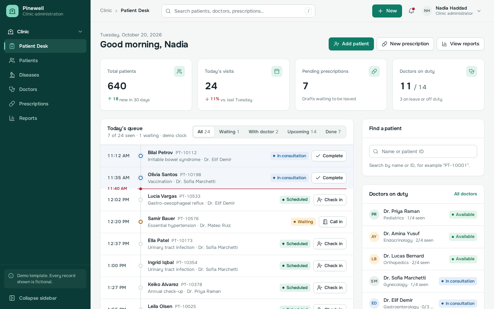
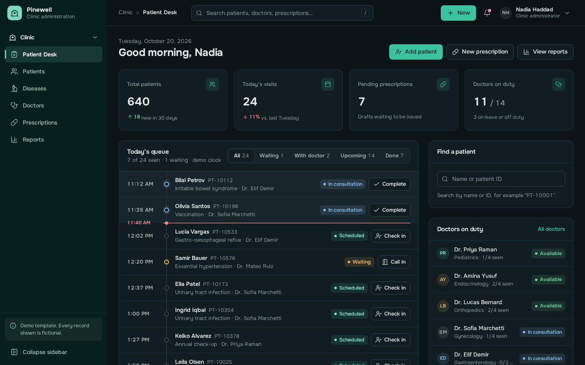
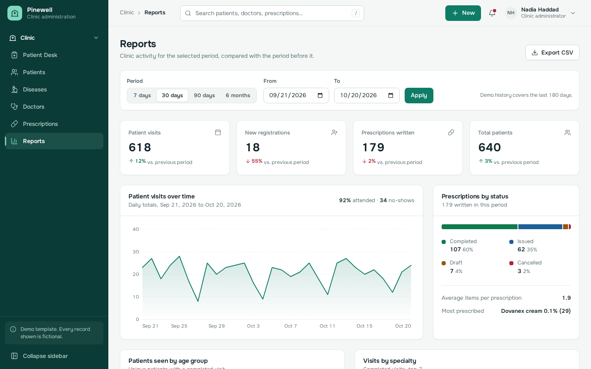
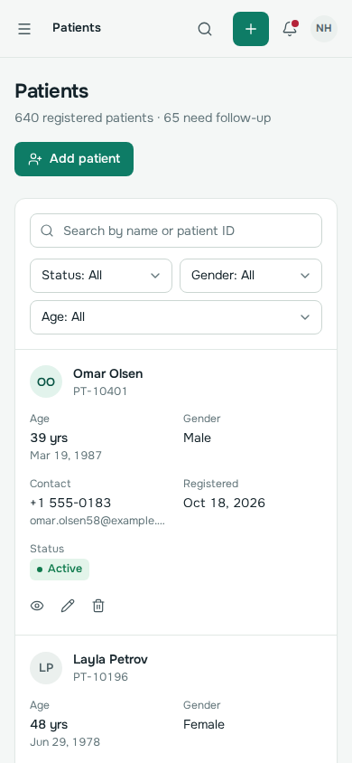

# Pinewell: Clinic Management Dashboard Template

A responsive clinic administration template built with **HTML, Tailwind CSS 4 and vanilla JavaScript**, bundled with Vite. It has six complete pages (Patient Desk, Patients, Diseases, Doctors, Prescriptions and Reports), a light and a dark theme, and working client-side interactions powered by generated demo data.

> **Demo data only.** Every patient, doctor, medication and record is fictional. Phone numbers use the reserved `555-01xx` range and e-mail addresses use `example.com`. The prescription screens are a UI demonstration, **not** a validated prescribing or clinical decision-support system. This is a front-end template. It is not production-ready for real healthcare operations, and it is not compliant with HIPAA, GDPR or any other regulation on its own. Handling real health information needs a secure backend, authentication, access control, audit logging, and the legal and compliance work your region requires.



| Dark theme | Reports | Mobile |
| --- | --- | --- |
|  |  |  |

## Features

- **App shell.** Dark pine sidebar with a collapsible nav group. On desktop it collapses to an icon rail with tooltips, and the choice is remembered. Below 1024px it becomes a slide-out drawer that closes with the close button, the backdrop or Escape, and keeps focus inside while open.
- **Top bar.** Breadcrumb, global search (press `/`, arrow keys work in the results), a "New" quick-action menu, notifications built from live data with "mark all as read", and an account menu with theme and demo-data controls.
- **Patient Desk.** KPI tiles, today's queue as a timeline with a "now" marker and working Check in / Call in / Complete actions, patient lookup, doctors on duty, recent activity, and a 30-day visits chart compared with the previous 30 days.
- **Patients.** Search, filters (status, gender, age group), sortable columns, pagination, add/edit with validation, a detail view with visit history, and delete confirmation.
- **Diseases.** Diagnosis reference list with code-format and unique-code validation, category and status filters, and case counts taken from the visit history.
- **Doctors.** Card directory with specialty and status filters and a workload summary. A doctor who has records can't be deleted; the dialog explains why and offers "Mark as off duty" instead.
- **Prescriptions.** Draft → Issued → Completed / Cancelled workflow, a multi-medication form, a detail sheet, and a print-only prescription layout.
- **Reports.** Date presets, a custom date range with validation, period-over-period KPIs, a visits trend chart (switches to weekly totals for long ranges), age and specialty distributions, prescription status, a doctor activity table, and CSV export.
- **Quality.** Design tokens, light and dark themes, reduced-motion support, visible focus states, labelled controls, native `<dialog>` modals (bottom sheets on phones), tables that turn into stacked cards on phones, and skeleton loading, empty and error states.

## Getting started

Requires **Node.js 20.11 or newer**.

```bash
npm install          # install dependencies
npm run dev          # start the dev server → http://localhost:5173/pages/patient-desk.html
npm run build        # production build → dist/
npm run preview      # serve the production build locally
```

The `dist/` folder is fully static and uses relative paths, so you can upload it to any static host or sub-folder.

> The project ships an `.npmrc` with `legacy-peer-deps=true`. This works around an npm 10.8 resolver bug (`Cannot read properties of null (reading 'edgesOut')`) triggered by Vite 8's optional peer dependencies.

### Tests

The end-to-end tests use Playwright and run against the production build (`playwright.config.js` builds and serves it automatically).

```bash
npm run test:install   # one-time: download Playwright's Chromium
npm test               # 35 tests across desktop (1440px) and mobile (390px)
```

They cover every page and nav link, the sidebar collapse and the mobile drawer, dropdowns, global search, the theme switch, form validation, CRUD on every entity, filters, sorting, pagination, the modal keyboard behaviour, the print layout, CSV export, chart keyboard access, and horizontal overflow and console errors on every page.

## Project structure

```text
clinic-template/
├── index.html                    # redirects to the Patient Desk
├── pages/                        # one small HTML entry per page (shell is rendered by JS)
├── assets/icons/clinic.svg       # favicon / Clinic mark
├── src/
│   ├── css/main.css              # design tokens, themes, component classes
│   └── js/
│       ├── main.js               # entry: mounts the shell, loads the page module
│       ├── config/
│       │   ├── navigation.js     # brand, user, nav groups + backend route map, persistence flag
│       │   └── pages.js          # list of page entries for the build
│       ├── core/
│       │   ├── dom.js            # escaping html`` templates, render(), helpers
│       │   ├── store.js          # client-side CRUD store (swap for API calls)
│       │   ├── icons.js          # icon registry (Lucide + custom Clinic mark)
│       │   └── format.js         # date / number helpers
│       ├── data/mock-data.js     # seeded fictional dataset generator
│       ├── components/
│       │   ├── shell.js          # sidebar, drawer, top bar, search, notifications, theme
│       │   ├── ui.js             # badges, avatars, modals, confirm, toasts, forms, dropdowns
│       │   ├── data-table.js     # search / filter / sort / paginate / stacked mobile layout
│       │   └── charts.js         # dependency-free SVG line chart, bar list, stacked bar
│       └── pages/                # one module per page
├── tests/                        # Playwright specs
├── docs/screenshots/
├── vite.config.js
└── playwright.config.js
```

Tailwind CSS 4 is configured in CSS (`@theme` in `src/css/main.css`), so there is no `tailwind.config.js`.

## Customisation

### Colours, type and shape

All colours live as CSS custom properties at the top of `src/css/main.css`: `:root` for the light theme and `[data-theme="dark"]` for the dark one. They're exposed to Tailwind through `@theme inline`, so utilities like `bg-surface`, `text-ink-3` and `bg-brand-soft` follow the theme automatically.

| Token | Light | Use |
| --- | --- | --- |
| `--pine` | `#0B3B36` | Sidebar |
| `--brand` | `#0E7C66` | Primary actions, active states, chart series |
| `--brand-soft` | `#E2F3EC` | Mint tints, icon wells |
| `--mint` | `#7FD8BE` | Active-nav accent, brand mark |
| `--canvas` | `#F4F7F6` | Page background |
| `--ink` | `#14232A` | Body text (`--ink-2`, `--ink-3` for secondary and muted) |
| `--success` / `--warning` / `--danger` / `--info` | | Status badges only, always paired with a label |

The typeface is **Onest** (variable), bundled locally through `@fontsource-variable/onest`. To change it, swap the import and `--font-sans`. Radii (`--radius-card`, `--radius-control`, `--radius-badge`) and shadows are tokens too.

The default theme is light. Users can pick Light, Dark or Match system from the account menu.

### Navigation and backend routes

Edit `src/js/config/navigation.js`. Each item has an `href` (the page in this template) and a `route` (the matching route in the host application, for example `/admin/clinic/patients`). Add groups to the `navigation` array to show more modules, such as Inventory. To add a page:

1. Create `pages/<id>.html` (copy an existing one and change `data-page` and `<title>`).
2. Add `<id>` to `src/js/config/pages.js`.
3. Add a module in `src/js/pages/<id>.js` that exports `default function (main) {}` and register it in `src/js/main.js`.
4. Add a nav item.

### Connecting a backend

All reads and writes go through `src/js/core/store.js` (`list`, `get`, `create`, `update`, `remove`). Replace those functions with `fetch` calls to your API and remove `data/mock-data.js`. Pages don't touch the data directly.

### Demo data and persistence

`app.persistDemoData` in `navigation.js` (default `true`) keeps demo edits in `localStorage`. Only fictional generated data is ever stored. To reset:

- use **Account menu → Reset demo data**, or
- clear the site's storage in DevTools, or
- set `persistDemoData: false` to start fresh on every load.

Outside clinic hours (08:30–17:30) the queue runs on a fixed **demo clock** (11:40), so the Patient Desk always shows a working day. The queue header labels this as "demo clock".

## Security notes

- All dynamic markup goes through the `html```  tagged template in `core/dom.js`, which escapes every interpolated value. `render()` and `appendHtml()` refuse plain strings, so unescaped input can't reach `innerHTML` by accident.
- No inline event handlers. No `eval`. No third-party scripts, CDNs or external requests at runtime.
- Form input is validated with the Constraint Validation API (required fields, formats, ranges) plus custom rules such as unique disease codes and dates that can't be in the future. Server-side validation is still required when you add a backend.
- CSV export quotes every cell and neutralises values that start with `=`, `+`, `-` or `@` (CSV injection).
- `localStorage` only ever holds the fictional demo dataset and UI preferences. **Don't** keep the browser store when you connect real patient data.

## Browser support

Current versions of Chrome, Edge, Firefox and Safari. The template relies on native `<dialog>`, the `inert` attribute and `color-mix()`.

## Known limitations

- Single user, client-side demo. There's no authentication, roles or real-time sync.
- Global search covers patients, doctors, prescription IDs and diseases. It doesn't search inside visit notes.
- The patient picker in the prescription form uses a native `<datalist>`. Its dropdown styling depends on the browser.
- Printing uses the browser's print dialog. There's no PDF generation.
- Charts are deliberately simple (line, bar list, stacked bar). Swap in a charting library if you need more chart types.

## Third-party licences

| Package | Licence | Use |
| --- | --- | --- |
| [Lucide](https://lucide.dev) | ISC | Icons (bundled, tree-shaken) |
| [Onest](https://fonts.google.com/specimen/Onest) via Fontsource | SIL Open Font License 1.1 | Typeface (bundled) |
| [Tailwind CSS](https://tailwindcss.com) | MIT | Styling (build time) |
| [Vite](https://vite.dev) | MIT | Build tool (dev only) |
| [Playwright](https://playwright.dev) | Apache-2.0 | Tests (dev only) |

All of these allow commercial redistribution. Keep their licence notices when you redistribute. The Clinic mark and every other asset in this repository are original.

## Licence

© All rights reserved. No open-source licence is granted for the template's own code. Choose a licence before you distribute or sell it.
